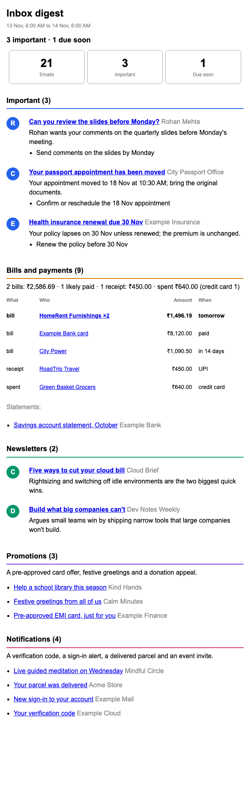
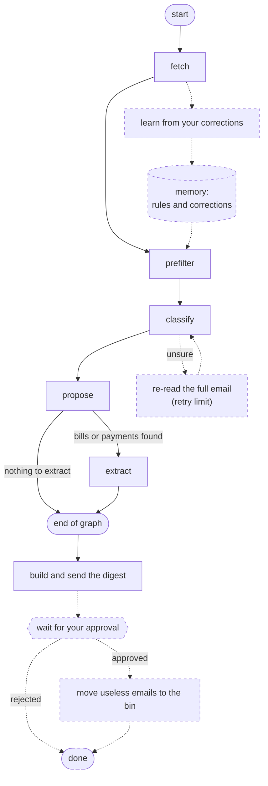
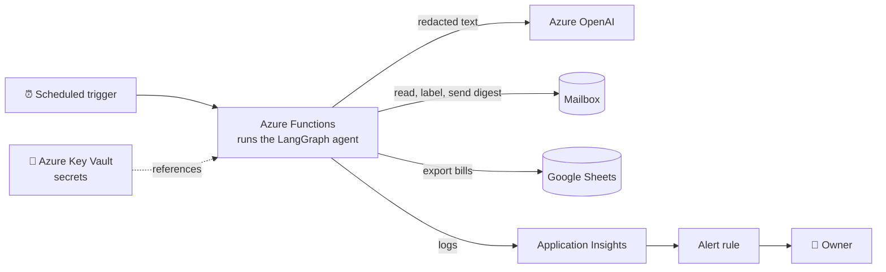

# Email Agent

**An AI agent that reads your inbox so you don't have to.**

The email agent helps you keep your inbox clean. It reads your inbox, tells you which emails need
your attention and what to do about them, and labels them, learning your labelling style as it goes.
Newsletters become short summaries instead of an unread pile, spam and promotions move to the bin
after your approval (coming soon), and bills and payments are pulled out. Everything arrives in a
single digest.

## Features

- **Knows what matters:** Emails from real people and anything with a deadline come first, each with
  the action it needs.
- **Summaries you can skim:** One line per newsletter and per important email; promotions and
  notifications collapse into a single line each.
- **Labels everything:** Each email gets one of your existing labels when one fits, or a dedicated
  label when none does. Labelled emails move out of your inbox, so it stays clear.
- **Understands your money:** Reads the biller, amount and due date from bills, matches payments to
  the bills they settle, flags what is due soon, and exports it all to a Google Sheet for downstream
  use such as expense tracking.
- **Adapts to you:** Follows the way you file your emails as it changes, and takes plain-English
  preferences such as *"delivery updates matter to me"*.
- **Keeps what matters in sight:** Important, unclear and starred emails always stay in your inbox.

<p align="center">
  
  <br><sub>A sample digest, rendered from invented data.</sub>
</p>

## Architecture

### The agent

The LangGraph workflow. Solid steps run today, wired exactly as in the code; dashed steps are on the
roadmap.



| Step | What it does |
|---|---|
| **fetch** | Reads the new emails for the configured window. |
| **prefilter** | Settles what it can without AI: emails you have already filed, and senders it has learned. |
| **classify** | Sorts the rest into categories with Azure OpenAI; uncertain answers are set aside for review. |
| **propose** | Chooses a label for each email. |
| **extract** | Runs only when bills or payments were found, and reads out amounts, dates and payees. |
| **learn** *(planned)* | Notices emails you moved to a different label and remembers them for future runs. |
| **re-read** *(planned)* | Gives uncertain emails a second look using their full text, within a retry limit. |
| **approval** *(planned)* | Pauses the run until you approve the clean-up listed in the digest. |

After the graph, the digest is assembled, labels are applied, bills are exported, and the digest is
sent. On the roadmap, every step's progress is saved, so a long run resumes where it stopped.

### In the cloud



## Inside the agent: LangGraph and LangChain

**LangGraph** runs the workflow. Every step reads from and writes to one typed, shared state, which
keeps each step small and independently testable. A conditional edge skips extraction entirely when
there is nothing to extract, and every step streams its progress, so a slow or stalled run shows
exactly where it is.

**LangChain** handles every conversation with the model. Prompts are templates, with your personal
preferences filled in safely at run time. Every answer is forced into a typed schema and validated
with Pydantic, and each answer is matched back to its email by id, never by position. Emails travel
in batches with a cap on parallel requests, which keeps runs fast, cheap and inside rate limits, and
an email the model refuses is retried on its own without failing the rest.

## Safety and privacy

- **Redaction before the model:** Account, card, phone and ID numbers, one-time codes and link paths
  are masked locally; amounts and dates are kept.
- **Prompt-injection defences:** Email text is treated as untrusted data, links written by the model
  are dropped, every link in the digest points back to your own mailbox, and all text is escaped.
- **Secrets stay secret:** They live in Key Vault, and errors are logged without their message text.
- **No training on your emails:** Azure OpenAI does not use your emails to train or improve its models.

## Preferences and Configurations

Two optional files hold your personal settings. Without them the agent uses neutral defaults.

- **`profile.toml`** (start from [`profile.example.toml`](profile.example.toml)): time zone, currency,
  which of your folders to learn from, where each category should be filed, and your preferences.
- **`digest.toml`**: the digest's sections, their order, and how each one is shown.

## Getting started

Requirements: Python 3.12, [uv](https://docs.astral.sh/uv/), a Google Cloud OAuth client with the
Gmail and Sheets APIs enabled, and an Azure OpenAI deployment.

```bash
uv sync                                       # install
uv run pytest                                 # run the tests
uv run python scripts/daily_run.py            # preview the digest, change nothing
uv run python scripts/daily_run.py --apply    # run it for real
bash scripts/deploy.sh                        # deploy to Azure Functions
```

## Roadmap

- **Approve before it acts:** The agent pauses and waits for your OK before moving clearly useless
  emails to the bin (recoverable for 30 days), adding a new label or sender rule, or sending a drafted
  reply. *(LangGraph interrupts and checkpoints)*
- **Learns from your corrections:** Move an email to a different label, and the next run remembers.
  *(long-term memory)*
- **Takes a second look when unsure:** Uncertain emails are re-read in full and classified again,
  within a retry limit. *(graph loops)*
- **Picks up where it left off:** Large backlogs resume from the last processed email after any
  interruption. *(durable execution)*
- **Chat with your inbox:** Ask "which bills are due this week?" and follow up in the same conversation.
- **Reply drafting:** An assistant that checks your calendar, past emails and bills log, drafts a
  reply, and waits for your approval.
- **Specialist agents:** Bills, newsletters and other categories each get a dedicated agent,
  coordinated by a supervisor.
- **Faster digests:** Each section is summarized in parallel and merged into one digest.
- **Evaluation and tracing** with LangSmith.
